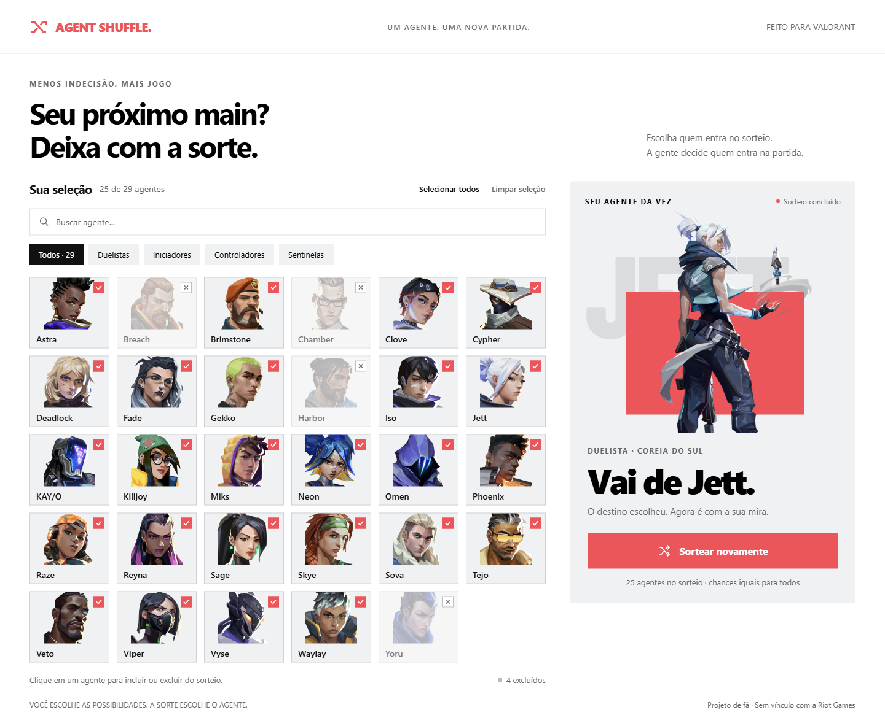

# Agent Shuffle

**Seu próximo main? Deixa com a sorte.**

Um sorteador de agentes de **Valorant** que deixa você escolher as possibilidades antes de sortear. Marque os agentes que aceita jogar, exclua os demais e descubra quem vai para a próxima partida.

Aplicação feita com HTML, CSS e JavaScript, com imagens locais e funcionamento offline. Não exige cadastro, instalação de dependências nem conexão com a conta do jogo.

## Layout no Paper

[](https://app.paper.design/file/01M5AYX8K9ZR2S69S7WNZ03BBT/p-1-0)

Layout original criado no [Paper](https://app.paper.design/file/01M5AYX8K9ZR2S69S7WNZ03BBT/p-1-0). Clique na imagem para abrir o arquivo de design.

> O layout demonstra uma seleção personalizada e um resultado. Na primeira abertura do aplicativo, todos os agentes estão selecionados e ele aguarda seu primeiro sorteio.

## Funcionalidades

- Incluir e excluir agentes individualmente.
- Selecionar todos ou limpar toda a seleção.
- Buscar agentes pelo nome, sem diferenciar maiúsculas e minúsculas.
- Filtrar a visualização por duelistas, iniciadores, controladores e sentinelas.
- Sortear apenas entre os agentes selecionados, com chances iguais.
- Mostrar o retrato, o nome e a função do agente sorteado.
- Salvar a seleção e o último resultado no navegador.
- Funcionar sem internet, inclusive com os retratos dos agentes.
- Adaptar a interface para computador, tablet e celular.
- Usar os controles por teclado e respeitar a preferência de movimento reduzido.

## Como executar

### Opção 1 — abrir diretamente

1. Baixe o projeto e extraia o ZIP, se necessário.
2. Abra o arquivo **`index.html`** em um navegador atualizado, como Edge, Chrome ou Firefox.
3. No Windows, você também pode dar dois cliques em **`Abrir Agent Shuffle.cmd`**.

Mantenha os arquivos do projeto e a pasta `assets/` juntos. Não é necessário instalar Node.js ou Python para usar o aplicativo dessa maneira.

### Opção 2 — servidor local para desenvolvimento

Se você já tem Python 3 instalado, abra um terminal na pasta do projeto e execute:

```bash
python -m http.server 8000 --bind 127.0.0.1
```

Depois, acesse [http://127.0.0.1:8000](http://127.0.0.1:8000). Para encerrar o servidor, pressione `Ctrl+C` no terminal.

Se também tiver Node.js e npm, `npm start` executa o mesmo comando. O projeto não precisa de `npm install`.

## Como usar

1. Clique nos retratos para incluir ou excluir agentes.
2. Use a busca e os filtros para encontrar quem deseja alterar.
3. Confira a quantidade de agentes na sua seleção.
4. Clique em **Sortear agente**.
5. Use **Sortear novamente** para fazer outro sorteio.

**A busca e os filtros só mudam a visualização.** Todos os agentes selecionados continuam participando, mesmo quando não aparecem por causa de um filtro.

Cada sorteio é independente: o mesmo agente pode sair novamente. Se houver apenas um agente selecionado, ele sempre será o resultado. Se não houver nenhum, o botão fica desativado.

Ao excluir o agente do último resultado, o painel volta a aguardar um novo sorteio.

## Tecnologias

| Tecnologia | Uso |
| --- | --- |
| HTML | Estrutura da interface e controles acessíveis |
| CSS | Layout, cores, animações e adaptação de tela |
| JavaScript | Seleção, busca, filtros e sorteio |
| `localStorage` | Memória das escolhas no navegador |
| Web Crypto | Geração dos números usados no sorteio |
| Node.js | Execução dos testes, opcional |
| Python e Pillow | Atualização das imagens, opcional |

O aplicativo não usa framework, servidor de aplicação ou banco de dados.

## Estrutura do projeto

```text
agent-shuffle/
├── index.html                  # Estrutura da tela
├── styles.css                  # Aparência e responsividade
├── app.js                      # Interface e ações do usuário
├── core.js                     # Regras de filtragem, seleção e sorteio
├── agents.js                   # Lista local de agentes
├── favicon.svg                 # Ícone do aplicativo
├── assets/                     # Retratos em WebP
├── docs/                       # Capturas de tela
├── scripts/
│   ├── build_standalone.py      # Gera um único HTML offline
│   └── update_agents.py         # Atualiza dados e imagens
├── tests/
│   └── core.test.cjs            # Testes das regras
├── Abrir Agent Shuffle.cmd     # Atalho para Windows
├── package.json                # Comandos de desenvolvimento
├── requirements-tools.txt      # Dependência da atualização de imagens
├── THIRD_PARTY.md               # Créditos das fontes e imagens
├── .gitattributes
├── .gitignore
└── README.md
```

## Entendendo o código

- **`index.html`** define onde ficam a busca, os cartões e o resultado.
- **`styles.css`** controla como esses elementos aparecem em cada tamanho de tela.
- **`agents.js`** guarda os dados que alimentam os cartões.
- **`core.js`** contém funções que recebem dados e devolvem resultados: filtrar agentes, recuperar uma seleção salva e escolher um índice aleatório.
- **`app.js`** conecta tudo isso aos cliques e atualiza a tela. A seleção é um `Set` de identificadores: ele guarda cada agente no máximo uma vez.

No sorteio, o programa cria uma lista somente com os agentes permitidos e escolhe uma posição dessa lista. O cálculo rejeita números que poderiam causar viés ao dividir os valores aleatórios entre as posições disponíveis.

## Testes

Para rodar os testes, use **Node.js 22 ou superior**:

```bash
npm test
```

Ou execute diretamente:

```bash
node --test tests/core.test.cjs
```

Os testes cobrem a combinação de busca e função, agentes elegíveis, seleção vazia, seleção com um único agente, cálculo do índice aleatório e recuperação de preferências salvas.

Para verificar a sintaxe dos arquivos JavaScript:

```bash
npm run check
```

## Gerar uma versão em arquivo único

Com **Python 3.10 ou superior**, execute na raiz do projeto:

```bash
python scripts/build_standalone.py
```

O resultado estará em **`release/Agent Shuffle.html`**. Esse arquivo inclui o código e as imagens e pode ser compartilhado sozinho. Não é necessário instalar Pillow para gerar essa versão.

A pasta `release/` é ignorada pelo Git porque contém arquivos gerados. Execute o comando novamente após alterar o código ou os agentes.

## Atualizar os agentes

O elenco é uma cópia local da resposta da [Valorant-API](https://valorant-api.com/), obtida em **19/10/2026**, com 29 agentes. A atualização não é automática.

Para buscar o elenco novamente, com internet e Python 3.10 ou superior:

```bash
python -m pip install -r requirements-tools.txt
python scripts/update_agents.py
```

O script atualiza `agents.js` e baixa os retratos em `assets/`. Ele usa a lista retornada pela API da comunidade; a disponibilidade dos dados depende dessa fonte. Revise os arquivos alterados antes de enviá-los ao GitHub. Gere novamente a versão em arquivo único, caso use essa distribuição.

## Colocar no GitHub

### Pelo site

1. Crie um repositório vazio chamado `agent-shuffle` na sua conta.
2. Extraia o ZIP deste projeto.
3. Envie os arquivos e as pastas **de dentro** da pasta extraída para a raiz do repositório.
4. Confira se `README.md`, `index.html` e `assets/` ficaram na raiz.
5. Salve o envio com uma mensagem como `Adiciona versão inicial do Agent Shuffle`.

O GitHub exibirá este README na página do repositório. Envie também `docs/` para que a imagem de apresentação apareça.

### Pelo terminal, se você já usa Git

Dentro da pasta do projeto:

```bash
git init
git add .
git commit -m "Adiciona versão inicial do Agent Shuffle"
git branch -M main
git remote add origin https://github.com/SEU_USUARIO/agent-shuffle.git
git push -u origin main
```

Substitua **`SEU_USUARIO`** pelo seu usuário e ajuste o nome do repositório, se necessário. Crie o repositório vazio no GitHub antes de executar esses comandos. A autenticação será solicitada pelo seu ambiente Git quando necessário.

## Armazenamento e limites

- O aplicativo guarda apenas os identificadores selecionados e o último resultado em `localStorage`.
- Esses dados ficam no navegador usado; não há sincronização entre dispositivos.
- Limpar os dados do navegador, trocar de navegador ou mudar o endereço/caminho do aplicativo pode alterar o acesso às preferências salvas.
- Se o armazenamento estiver bloqueado, a aplicação continua funcionando durante a sessão e exibe um aviso.
- O sorteador não escolhe o agente dentro do Valorant: ele mostra uma sugestão para você selecionar no jogo.

## Créditos

Dados e retratos: [Valorant-API](https://valorant-api.com/). Referência visual: [layout no Paper](https://app.paper.design/file/01M5AYX8K9ZR2S69S7WNZ03BBT/p-1-0).

Projeto de fã, sem vínculo com a Riot Games. Valorant, seus personagens e imagens pertencem aos respectivos titulares. Consulte [THIRD_PARTY.md](THIRD_PARTY.md) para as fontes dos recursos.
